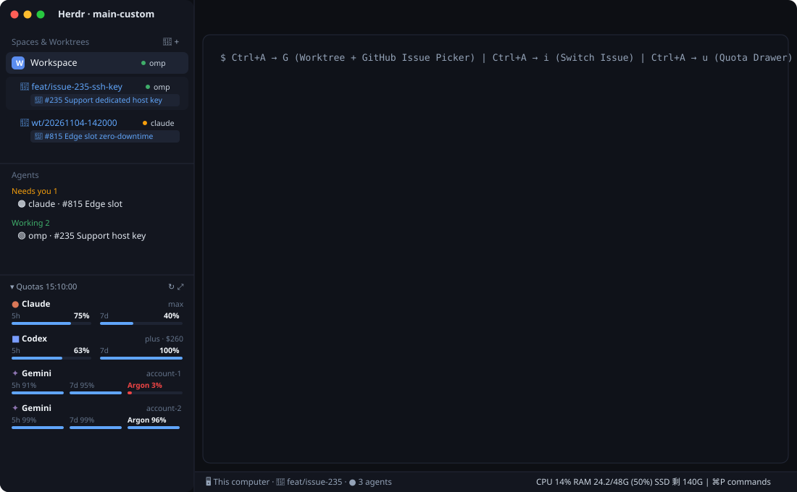

# herdr-max

A customized [Herdr](https://herdr.dev) desktop layout (`main-custom`) and mod suite designed for multi-repo workspaces, issue-driven Git worktrees, TUI-style `Ctrl+A` prefix navigation, multi-account AI quota tracking, and lightweight system telemetry.



---

## Features / 核心功能

### 1. `spaces-plus` — Unified Spaces & Worktrees Tree with Live Agent & Issue Badges
- **Automatic Worktree Nesting**: Nests linked Git worktrees (`~/.herdr/worktrees/<repo>/<branch>`) directly under their parent Space—supporting both single-repo Spaces and multi-repo umbrella folders.
- **Live Agent Status Pill**: Shows which coding agent (`omp`, `claude`, `codex`, etc.) is active inside each Space/Worktree and its real-time status (`working`, `blocked`, `done`, `idle`).
- **Dynamic Issue Binding**: Displays the currently bound GitHub Issue (`🎯 #235 ...`) on a second line under each Worktree. Click the badge (or press `Ctrl+A` → `i`) at any time to switch or rebind the Issue as your work evolves.
- **Zero-Friction Worktree Auto-Cleanup**: Whenever the set of open Spaces/panes changes (e.g. you close a Worktree Space with `Cmd+W`, `Ctrl+A` → `x`, or `exit`), `~/.herdr/worktrees` is scanned and clean worktrees that are no longer open are removed in the background (`git worktree remove` + `git branch -d`). If uncommitted files or unpushed commits exist, a safety dialog prompts before anything is deleted.
  - **Merged work counts as pushed**: a worktree whose HEAD is already in `origin/<default>` (normal merge / fast-forward), or whose GitHub PR was **squash/rebase-merged** with exactly this head commit (checked with `gh pr list --state merged`, 8s timeout), is cleaned without a prompt and its local branch is deleted with `-D` (`-d` refuses squash-merged branches). Dirty worktrees always still prompt.
  - Only worktrees under `~/.herdr/worktrees/<repo>/<branch>` are scanned, so create worktrees there (`git worktree add ~/.herdr/worktrees/<repo>/<branch> -b <branch> origin/main`) to have them cleaned automatically.

### 2. `worktree-plus` — Multi-Repo & GitHub Issue Worktree Manager (`Ctrl+A` → `G`)
- **Umbrella Workspace Support**: If your current Space is a parent folder containing multiple Git repositories, Step 1 lets you pick which sub-repository to branch from.
- **3 Branch Creation Modes**:
  1. **Timestamp (`omp` style)**: `wt/YYYYMMDD-HHMMSS` (press `Enter` immediately without typing).
  2. **GitHub Open Issues**: Fetches open issues via `gh issue list` (automatically honoring `.envrc` / `direnv` per repo) and generates `feat/issue-<N>-<slug>` or `fix/issue-<N>-<slug>`.
  3. **Custom Branch Name**: Type any branch name directly.
- **Switch / Rebind Issue Mode (`Ctrl+A` → `i`)**: Re-assign any open Worktree or Space to a different GitHub Issue or custom task note on the fly.

### 3. `status-quota` — Adaptive Bottom-Left Multi-Account Quota Panel (`Ctrl+A` → `u`)
- **Real-Time Multi-Account Quotas**: Reads **Claude** (OAuth 5h/7d), **Codex** (5h/7d + credit balance), and **multiple Google Gemini / Antigravity accounts** (`5h`, `7d`, `Argon`) from `~/.omp/agent/agent.db` and local credentials.
- **Spacious Two-Tier Cards**: Separates provider/account headers from per-window progress bars so account names and percentages never truncate.
- **3-Way Height Control**:
  - Auto-resizes (`layout.resize`) to fit all active provider cards without clipping.
  - Mouse-draggable top divider inside the sidebar.
  - Click the `▾ Quotas` header to collapse/expand (`28px` folded rail).
- **Detail Drawer**: Click any card or press `Ctrl+A` → `u` to open the full countdown popup with exact reset timestamps.

### 4. `workspace-status-plus` + `system-monitor` — Bottom Bar with macOS Telemetry (powered by `macmon`)
- Right side of the bottom status bar shows live `CPU %`, `GPU %`, `TEMP`, `RAM used/total GB (%)`, and `SSD free GB`, sampled with [`macmon`](https://github.com/vladkens/macmon) (`brew install macmon`, Apple Silicon only; found via PATH plus both Homebrew prefixes) plus `df`.
- Polls only when the Herdr window is active (default every 8s; the first poll is immediate).
- **Click the readout** to open the `system-monitor` popup: CPU / GPU / RAM tiles, SSD, temperature, power, fans, and local / Tailscale / public IPv4 (the public IP is looked up through `api.ipify.org` only when the popup opens or is refreshed).
- The popup also sets the **refresh interval** (2s / 5s / 8s / 15s / 30s / manual) and has buttons that open **Activity Monitor** or **macmon** in a new Herdr tab.

### 4b. `toast` — Restyled Notifications
- Rounded card with a level-colored border, accent strip, and icon badge. Where a toast appears is decided by Herdr and cannot be changed from a mod.

### 5. `tmux-prefix` & `picker-copy` — Herdr TUI (`Ctrl+A`) Keybindings
- Brings Herdr TUI's `Ctrl+A` prefix workflow to Herdr App, reading bindings dynamically from `keys.json` (`mod:tmux-prefix`).
- Includes repeatable pane navigation (`h/j/k/l`), space/tab switching, side panel toggles (`f` for Files, `d` / `r` / `o` for Git Panel → Changes / Graph / Remote), and `Ctrl+J/K` / `Ctrl+N/P` list navigation across pickers.

### 6. `git-graph` — Branch / Merge Route Map in the Right Panel (`Ctrl+A` → `r`)
- Draws the commit graph (lanes, merge curves, merge rings) of the repo under the focused pane, newest first (latest 500 commits).
- Ref chips per commit: `HEAD`/current branch, local branches, `origin/*` remotes, tags.
- Header toggle switches between **All branches** (local + remote + tags) and **HEAD only**; `↻` forces a refresh. The graph also auto-refreshes every 6s when refs change.
- Click a commit to open its detail drawer: hash, author, date, message body, changed files (first-parent diff for merges).
- **Right-click a commit → menu**: **顯示詳細資訊** opens an 88% × 92% dialog like the PR one: header (hash, ref chips, subject, author, date, parents), the full message, the changed files as a folder tree on the left (collapsible folders, `+N −N` per file, a filter box, `j`/`k` to switch) and the selected file's diff on the right (first-parent diff for merges, root diff for the first commit; the **配色** button cycles the diff colors). The menu also copies the full hash or the subject.
- Lives inside the unified **Git** right-hand panel (`Changes` | `Graph` | `Remote`). The tab bar (`tabs-plus`) keeps a clean 2-button layout: **Files** and **Git**.

### 7. `git-hub` & `git-remote` — Unified Git Panel (`Changes | Graph | Remote`) & Issue-to-Worktree (`Ctrl+A` → `o`)
- Consolidates local working-tree diff (`Changes`), branch route map (`Graph`), and remote forge (`Remote`: Issues, PRs, Actions CI, Milestones, Projects, Repo overview) under a single **Git** button in the top-right tab bar (`mods/git-hub` switcher + `mods/git-remote`). `git-remote` was called `github` before; `install.sh` leaves an old `~/.config/herdr-app/mods/github` in place, delete it by hand after upgrading.
- **Platform detection**: the sync row shows a chip with the platform of `origin` (GitHub, GitLab, Bitbucket, Codeberg, Gitea/Forgejo, Azure DevOps, SourceHut, AWS CodeCommit, GitHub Enterprise; any other host shows its hostname), decided from the remote URL's host only (`mods/git-remote/platform.js`, no network). Only GitHub is wired up for PRs / Issues / CI (through `gh`): in a GitLab, Bitbucket, … folder the Remote tab says which platform it found and that it is not supported yet, instead of a misleading "gh not found" / "no GitHub repo" message. `Changes`, `Graph` and Pull work on any platform.
- **Per-folder GitHub account**: with more than one account logged in to `gh`, the Remote tab acts as the account of the focused folder instead of gh's single global "active" one (which any process can flip with `gh auth switch`). Order: the account picked from the dropdown on the chip in the filter row (lists **auto** and every logged-in account with the current one ticked; remembered per space folder and its subfolders) → the account the folder's nearest `.envrc` names with `GH_TOKEN="$(gh auth token --user NAME)"` (the direnv convention) → gh's active account. The token is read inside a shell and placed in `GH_TOKEN` there (never in an argument list); an account gh doesn't know fails with an error instead of quietly using another. Remote machines keep their own gh. Cached lists are keyed by account.
- **One-click Pull**: a sync row under the tab bar shows the current branch with `↓behind` / `↑ahead` (read from the last fetch, no network) and a **↓ 拉取** button that runs `git pull --ff-only` in the focused pane's repo (also on remote machines). Fast-forward only: no merge commits, and a diverged branch fails with a toast instead of being rewritten. The result (already up to date / N commits pulled / failure reason) shows as a notification. The panel header height in `layouts/main-custom.json` is `72px` to fit this row.
- **88% × 92% PR & Issue Dialog**:
  - **Conversation & Timeline**: Markdown with inline images, comments, review verdicts, labels, assignees, and close/reopen/comment composer.
  - **Files Changed (Diff) Tab**: Folder-tree file column with a filter box (`+`/`−` counts, collapsible folders) + virtualized unified diff viewer inside the PR dialog. The commit dialog in `git-graph` uses the same layout; `filetree.js` exists in both mods and must stay identical (a mod cannot import another mod's files).
  - **Direct PR Merge**: Embedded in `mergeBox` with **Merge commit / Squash and merge / Rebase and merge** confirmation and `--match-head-commit` SHA guard.
- **1-Click Issue → Herdr Worktree (`spaces-plus` + `worktree-plus` integration)**:
  - Click the branch icon on any hovered Issue row, or click **Open Worktree** inside the Issue dialog, to automatically create `~/.herdr/worktrees/<repo>/feat/issue-<N>-<slug>`, bind `🎯 #<N>` in `shared("worktree-plus.meta")`, and switch to the new nested Worktree Space.
  - **Start agent** (PR or Issue, and the review dialog's 啟動) goes through one shared `startagent.js`: always in the space you are looking at; beside a terminal of the repo in that space as a split pane to the right (the brief is sent with `hc send` once the agent is up), otherwise as a new tab with the brief as its first task. For a **PR**, if a worktree of the local clone already has the PR's branch checked out, the agent starts there and the brief names that path and says not to `gh pr checkout` (without one, it still tells the agent to check the PR out). On an Issue the `🌱 在新 Worktree 啟動并綁定 Issue` toggle launches the agent inside the isolated Issue Worktree instead.

---

## Keybindings (`Ctrl+A` Prefix & Global)

| Key | Action | Description |
|---|---|---|
| `Ctrl+A` → `h / j / k / l` | `pane.go` | Move focus left / down / up / right (repeatable within 500ms) |
| `Ctrl+A` → `v` or `\` | `pane.split:right` | Split pane right |
| `Ctrl+A` → `-` | `pane.split:down` | Split pane down |
| `Ctrl+A` → `G` (`Shift+G`) | `worktree-plus` | Create Git Worktree (Timestamp / GitHub Issue / Custom) |
| `Ctrl+A` → `i` | `worktree-issue` | Bind or switch the current Worktree's GitHub Issue |
| `Ctrl+A` → `u` | `status-quota` | Open AI Quota & Reset Countdown drawer |
| `Ctrl+A` → `f` | `files` | Toggle right-hand Files panel |
| `Ctrl+A` → `d` | `changes` | Toggle right-hand Git panel → **Changes** (diff & commit) |
| `Ctrl+A` → `r` | `graph` | Toggle right-hand Git panel → **Graph** (branch route map) |
| `Ctrl+A` → `o` | `github` | Toggle right-hand Git panel → **Remote** (Issues / PRs / Actions) |
| `Ctrl+A` → `g` / `w` | `picker-copy` | Open Goto Picker (with empty spaces expanded & `Ctrl+J/K` support) |
| `Ctrl+A` → `m` | `new-menu` | Open New Agent / Tab menu |
| `Ctrl+A` → `c` / `n` / `p` | `tab.*` | New tab / Next tab / Previous tab |
| `Ctrl+A` → `J` / `K` (`Shift+J/K`) | `space.next` / `prev` | Next / Previous Space |
| `Ctrl+Shift+L` | `layout.switch` | Toggle between `main-custom` and Herdr's default `main` layout |

---

## Installation

### Option 1: One-Line Script
```bash
git clone https://github.com/maxjkfc/herdr-max.git ~/code/herdr-max
~/code/herdr-max/install.sh
```

### Option 2: Ask Your Agent in Herdr
Paste into any agent running inside Herdr:
> Read `https://github.com/maxjkfc/herdr-max` (`RECIPE.md`) and install the `main-custom` layout and mods into `~/.config/herdr-app`.

---

## Rollback / Uninstall
`herdr-max` never overwrites Herdr's built-in `layouts/main.json` or built-in mods (`spaces`, `worktree`, `workspace-status`, `picker`).
- Press **`Ctrl+Shift+L`** at any time to switch back to the default `main` layout.
- Your previous `keys.json` is backed up to `~/.config/herdr-app/keys.json.bak`.

## Scroll & Search Keys

| Key | Action |
|---|---|
| `Cmd+F` | `terminal.search` — find in the focused terminal's screen and scrollback (Herdr app 0.1.13+) |
| `Cmd+Shift+K` / `Cmd+Shift+J` | Scroll history up / down 3 lines (vim-style) |
| `Cmd+Ctrl+G` / `Cmd+Ctrl+Shift+G` | Scroll to top / bottom |
| `Cmd+Shift+↑` / `↓` | Scroll half a page up / down |
| `Cmd+Shift+Home` / `End` | Scroll to top / bottom |

## Agent Icons

`programs.json` gives `omp` (Oh My Pi) its own icon in the Agents list and pane headers (`icons/omp.svg`, taken from [can1357/oh-my-pi](https://github.com/can1357/oh-my-pi), MIT). `install.sh` copies the icon and only creates `programs.json` if you don't already have one.

## Files (`files-plus`)

A fork of Herdr's built-in `files` panel (`main-custom` shows it instead; the built-in is untouched). Under the header a row shows what the buttons act on, with **Finder**, **Zed** and **Chrome** buttons: the file being previewed, else the folder you last clicked, else the project root. **Right-click any row** (file or folder) for a menu at the pointer: Finder, Zed, Chrome, or 複製路徑 (copies the absolute path). Finder reveals a file (selects it) or opens a folder; Zed and Chrome open the path (`open -a Zed|"Google Chrome" <path>`, macOS). Buttons and menu are off for a space on another machine, whose paths aren't on this computer.

## Review (`review`)

The **審查** button in the Git panel's sync row (next to **↓ 拉取**) opens a review dialog of the repo under the focused pane, the same layout as the commit dialog: a changed-files folder tree with a filter on the left, the selected file's syntax-colored diff on the right. It also covers what the Changes panel does: the **worktree** button in the header (shown when the repo has more than one worktree) lists every worktree with its branch and how many uncommitted entries it holds, so you can look at a worktree an agent works in without focusing a terminal there (each worktree has its own scope and comment drafts); and when the shown worktree has uncommitted changes, a commit box under the file tree runs `git add -A` and `git commit` there (the box says how many changes go to which branch and worktree). Apart from that box and its own comment drafts, review writes nothing. Three scopes (keys `1` `2` `3`, remembered per repo; a branch that has left its base opens in the third):

| Scope | Compares |
|---|---|
| 1 未提交 | working tree vs `HEAD` |
| 2 最後一個 commit | the commit before `HEAD` → working tree (so the last commit plus anything uncommitted) |
| 3 對 base | the merge-base with the base branch → working tree. Base is `origin/HEAD`, else `main`, else `master` |

Untracked files are listed too (marked 新). Diffs are read per file when picked, with the same safe git flags as the Changes panel (no `index.lock`, no fsmonitor, no index rewrite). `j`/`k` switch files, `r` re-reads, `Esc` closes. It is modelled on [herdr-reviewer](https://github.com/vytasgavelis/herdr-reviewer).

**Comments → agent.**
- Click a diff line to comment on it; click another line to widen a one-line selection to a range; click the same line again to deselect; click an `@@` header to select the whole hunk. Write the comment in the box below the diff and press **加入留言** (or `Cmd/Ctrl+Enter`). Commented lines get an accent edge.
- Drafts are kept per repo and scope (they survive closing the dialog and restarting Herdr), listed under the file tree as **待送出留言**: click one to jump to its lines and edit it, `✕` deletes it. A draft finds its lines again after a reload by kind, line number and text, falling back to kind and text when only the number moved; if the lines are gone it is marked （過期）.
- **送出審查 · N** opens the send dialog: the agents are listed with the one working in this repo (or its worktree) first, then one whose space is this repo, then the rest; add a note and send. The message names the repo and scope and lists every comment under `### file, lines a–b` with the quoted lines in a `diff` fence, sorted by file and line. It is sent with `hc send`; if the agent is working or blocked you confirm first, because the text is typed into its input. With no agent running you can start one: it opens as a split pane to the right of the repo's terminal (same tab; the focused one, else one in the current tab), and the review is sent to it once it is up (1.5 s after it appears, waiting up to 10 s for it to be recognised as an agent, then sending into the pane anyway). With no terminal in the repo (or on a remote machine) it opens in a new tab in the current space with the review as its first task. After sending, the drafts are cleared and the dialog closes.
- **Right-click** a line (or the selection, or a hunk header) to ask an agent about those lines: same dialog, with your question first and the quoted lines after it. Drafts are untouched.

## PR Diff Viewer

In the PR dialog the changed files are a column on the left of the diff (virtual list, `j`/`k` or `↑`/`↓` to switch, `+N −N` per file); the selected file's diff fills the right, **syntax-colored** in your theme's colors (JS/TS, Python, Rust, Go, C-family, Java/Kotlin, Ruby, PHP, shell, SQL, CSS, HTML/XML, YAML/TOML, JSON, Swift; other files stay plain). The **配色** button in the diff header cycles the diff colors (theme / vivid / GitHub / blue-orange colorblind-friendly) and remembers the choice. Add presets in `DIFF_PALETTES` in `mods/git-remote/diffview.js`. The commit dialog in `git-graph` renders its diff with the same `diffview.js`. The tokenizer (`highlight.js`) is from [herdr-reviewer](https://github.com/vytasgavelis/herdr-reviewer) (MIT, see `THIRD-PARTY-NOTICES`).

## Development

| Command | What it checks |
|---|---|
| `bun test tests/` | Pure logic: remote-URL platform detection (`platform.js`), unified-diff parsing (`diff.js`), the changed-files folder tree (`filetree.js`), the syntax tokenizer (`highlight.js`), agent briefs (`brief.js`), review drafts / messages / agent matching (`review/drafts.js`), worktree list parsing (`review/worktrees.js`). |
| `scripts/check-mirrors.sh` | Files that must be identical copies because a mod cannot import another mod's files (`platform.js`, `diff.js`, `filetree.js`, `highlight.js`, `diffview.js`, `startagent.js`). Add pairs to `PAIRS` in the script. |
| `scripts/diff-live.sh [-d]` | What the repo ships vs what runs in `~/.config/herdr-app` (`HERDR_APP_HOME`): lists differing or missing files, `-d` prints the diffs. Run it before opening a PR so live fixes don't stay out of the repo. |

The `worktree-plus` auto-clean leaves a worktree alone for 6 hours unless it has been open in a Herdr space at least once, so a worktree made with plain `git worktree add` is not removed the moment it is created. Mark a worktree permanent with `wt-helper.py keep-wt <path>`.

## License
Apache-2.0
