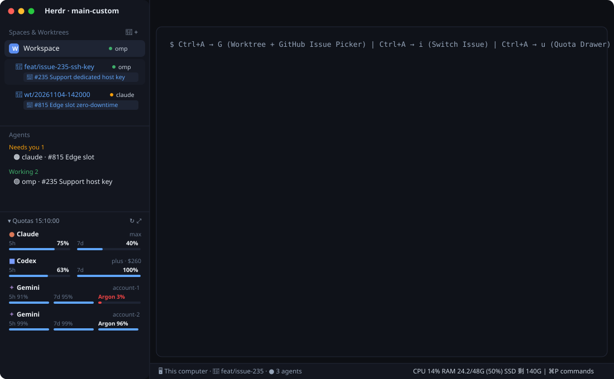

# herdr-max

A developer-focused Herdr desktop layout (`layouts/main-custom.json`) and modular extensions (`spaces-plus`, `worktree-plus`, `status-quota`, `workspace-status-plus`, `tmux-prefix`, `picker-copy`, `tabs-plus`, `git-hub`, `git-graph`, `git-remote`) that combine Spaces and Git Worktrees into a single tree with live agent & GitHub Issue badges, bring Herdr TUI's `Ctrl+A` prefix workflow to the desktop app, track multi-account Claude/Codex/Gemini quotas in the bottom-left sidebar, unify `Changes | Graph | Remote` into a single right-hand **Git** panel (with PR diff/merge and 1-click Issue-to-Worktree), and display lightweight macOS CPU/RAM/SSD stats in the bottom bar.

## What you see

- **Left Sidebar (`268px`, resizable)**:
  1. **Top (`spaces-plus`, weight 1)**: Header `Spaces & Worktrees` with `🌱` (New Worktree) and `+` (New Space) buttons. Worktree spaces (`~/.herdr/worktrees/<repo>/<branch>`) nest directly beneath their parent Space (supporting both single repositories and multi-repo umbrella directories). Each row shows a live agent status pill (`omp`, `claude`, `codex` with status dot) and a clickable second-line Issue badge (`🎯 #235 ...` or `+ 綁定處理中的 Issue…`).
  2. **Middle (`agents`, weight 1)**: Built-in Herdr Agents list grouped by urgency (`Needs you`, `Done`, `Working`, `Idle`).
  3. **Bottom-Left (`status-quota`, auto-sized `256px` or `28px` when folded, draggable top border)**: Header `▾ Quotas <updatedTime>` with `↻` (force refresh) and `⤢` (open detail popup). Lists each provider/account card with official Herdr icons (`icons/claude.svg`, `icons/codex.svg`, `icons/gemini.svg`), plan/account badge on the right, and per-window (`5h`, `7d`, `Argon`) percentage + color-coded progress bar columns underneath.
  4. **Sidebar Footer (`workspace-chrome`, `69px`)**: Settings & Add machine controls.
- **Main Work Area (Right)**:
  1. **Top (`tabs`, `42px`, mod `tabs-plus`)**: Tab bar cloned from Herdr's `tabs`, keeping a clean 2-button right-hand panel toggle: **Files** and **Git**.
  2. **Center (`work-body`)**: Active terminal panes with collapsible right-hand `panel` (`files` and `git` stack, `368px`). Inside `git`, a 40px `git-hub` switcher bar toggles `git-body` between **Changes** (`Ctrl+A` → `d`), **Graph** (`git-graph`, `Ctrl+A` → `r`), and **Remote** (`github`, `Ctrl+A` → `o`, with 88%×92% Issue/PR dialogs, PR Files Changed diff tab, direct PR merge, and 1-click Issue-to-Worktree creation).
  3. **Bottom Status Bar (`workspace-status-plus`, `28px`)**: Left shows machine, git branch, and agent count; right shows live `CPU %`, `RAM used/totalG (%)`, `SSD 剩 G`, and the command palette shortcut (`⌘P commands`).

## How it behaves

- **Creating & Switching Worktree Issues (`Ctrl+A` → `G` / `Ctrl+A` → `i`)**:
  - Pressing `Ctrl+A` then `Shift+G` (or clicking `🌱` in the Spaces header) opens `worktree-plus`. If the current directory is an umbrella workspace containing child git repos, Step 1 lists those child repos; Step 2 offers timestamp branch creation (`wt/YYYYMMDD-HHMMSS`), open GitHub Issues (`feat/issue-<N>-<slug>`), or custom input.
  - Clicking the Issue badge on any Worktree row in `spaces-plus` (or pressing `Ctrl+A` → `i`) opens `worktree-plus` in `"issue"` mode to rebind that Worktree to any open GitHub Issue or custom task note, persisted reactively via `shared("worktree-plus.meta")`.
- **Automatic Worktree Cleanup**:
  - `spaces-plus` watches `spaces()` and `panes()` signatures. When a Worktree under `~/.herdr/worktrees/` has no open Space or Pane, `wt-helper.py scan-orphans` checks `git status --porcelain` and unpushed commits:
    - If clean and pushed/merged, it silently runs `git worktree remove` and `git branch -d`.
    - If uncommitted files or unpushed commits exist, it opens `worktree-plus` in `"remove"` mode with 3 choices: delete worktree + branch, delete worktree only, or keep on disk (`~/.cache/herdr-quota/kept-worktrees.json`).
- **Quota Monitoring & Drawer (`Ctrl+A` → `u`)**:
  - `status-quota` runs `fetch-quota.py` every 120s, reading Claude OAuth usage, Codex rate limits + credit balance, and all Google Antigravity/Gemini accounts recorded in `~/.omp/agent/agent.db`.
  - Clicking any quota card or pressing `Ctrl+A` → `u` opens a `480×540` popup showing full reset countdowns (`1h 50m (16:29)`).

## Built from

- **Layout**: `layouts/main-custom.json`
- **Mods**:
  - `mods/spaces-plus/main.js` (`mod.json`)
  - `mods/worktree-plus/main.js` + `wt-helper.py` (`mod.json`)
  - `mods/status-quota/main.js` + `fetch-quota.py` (`mod.json`)
  - `mods/workspace-status-plus/main.js` (`mod.json`)
  - `mods/tmux-prefix/main.js` (`mod.json`)
  - `mods/picker-copy/main.js` (`mod.json`)
  - `mods/git-graph/main.js` + `graph.js` (`mod.json`)
  - `mods/tabs-plus/main.js` + `graph.svg` (`mod.json`)
  - `mods/git-hub/main.js` (`mod.json`)
  - `mods/git-remote/` (`main.js`, `viewer.js`, `actions.js`, `gh.js`, `platform.js`, `ui.js`, `brief.js`, `run.js`, `timeline.js`, `media.js`, `log.js`, `mod.json`)
  - `mods/review/` (`main.js`, `send.js`, `drafts.js`, `diff.js`, `diffview.js`, `filetree.js`, `highlight.js`, `mod.json`; `diff`/`diffview`/`filetree`/`highlight` are mirrors of the `git-remote` ones, see `scripts/check-mirrors.sh`; `drafts.js` is pure and tested)
  - `mods/scrollback/main.js` (`mod.json`)
- **Keys**: `keys.json` (`global`, `terminal`, `mod:tmux-prefix`, `mod:picker-copy`, `mod:worktree-plus`, `mod:git-remote`, `mod:git-graph`, `mod:scrollback`)

## Watch out

- `Input` in `gpui-base` must stay mounted (not conditionally hidden while async data loads) so `this.input.focus()` succeeds when a dialog opens.
- Repeating timers in `gpui-kit` use `cx.timer.every(ms, fn)`, whereas `cx.timer.after(ms, fn)` is one-shot.
- When opening a popup mod from another overlay without a target coordinate, omit `"at": "top"` or call `run("mod.open", { name })` so `mod.json`'s overlay spec is used.

## Done when

- `herdr-app check` passes on `mods/spaces-plus`, `mods/worktree-plus`, `mods/status-quota`, `mods/workspace-status-plus`, `mods/tmux-prefix`, `mods/picker-copy`, `mods/git-graph`, `mods/tabs-plus`, `mods/git-hub`, `mods/git-remote`, and `mods/scrollback`.
- `herdr-app status` reports `"layout": "main-custom"` and `"errors": []`.
